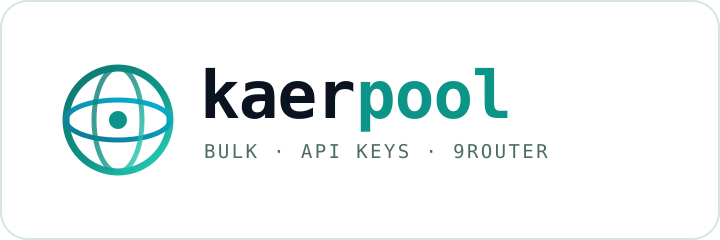

<div align="center">

<picture>
  <source media="(prefers-color-scheme: dark)" srcset="brand/logo.svg">
  
</picture>

**Cuentas Kaer API en lote → claves API → un único endpoint compatible con OpenAI → 9Router. Sin dependencias.**

[](https://nodejs.org)
[](#requisitos)
[](https://9router.com)
[](#úsalo-como-openai)
[](#requisitos)
[](LICENSE)
[](#configuración)

[English](README.md) · [Indonesia](README.id.md) · [中文](README.zh.md) · [日本語](README.ja.md) · [Español](README.es.md)

</div>

---

**kaerpool** convierte cuentas de Kaer API en una pasarela que se autorrepara.
Crea cuentas con un buzón desechable, verifica el código recibido por correo,
emite una clave `kaer_live_...` para cada una, las mantiene en un pool rotatorio
y registra ese pool como un único proveedor en [9Router](https://9router.com).

Sin `npm install`. Sin puppeteer. Solo `node`.

```
 registro ──► buzón ──► verificación ──► clave API ──► pool :8791 ──► 9Router ──► tu cliente
```

## Por qué

Cada cuenta nueva de Kaer API empieza con **$10 de crédito gratis**. Una cuenta
es una demo; un pool es una pasarela real que sobrevive a un saldo agotado, un
429 o una caída del proveedor:

- **Un solo comando** — `kaerpool create 5` aprovisiona cinco cuentas completas.
- **Claves reales, no cookies** — la cookie de sesión web no puede llamar a
  `/v1`; kaerpool emite la clave `kaer_live_...` que sí puede.
- **Pool autorreparable** — round-robin, cooldown exponencial, failover y
  expulsión al recibir 402 para que nunca se atasque una petición.
- **Nativo para 9Router** — crea el nodo del proveedor, conecta cada clave, la
  verifica y te entrega la clave del router.
- **Sin dependencias** — un `node`, ~1.6k líneas, MIT.

## Requisitos

- Node.js **18+** (solo `fetch` global y módulos `node:`).
- Una instancia de 9Router — autoalojada (`PORT=20128`) o alojada.
- Salida HTTPS hacia `api.kaer.ai`, `app.kaer.ai` y `api.mail.tm`.

## Instalación

```bash
git clone https://codeberg.org/0xgetz/kaerpool.git
cd kaerpool
node bin/kaerpool.js --help      # o: npm link → kaerpool --help
```

## Inicio rápido

```bash
# 1. crear cuentas
kaerpool create 3

# 2. ver el resultado
kaerpool list
kaerpool balance

# 3. servir endpoints compatibles con OpenAI
kaerpool serve --port 8791 &

# 4. registrarlo en 9Router (escribe data/router.json)
kaerpool connect --base http://127.0.0.1:8791/v1 \
                 --router http://127.0.0.1:20128 \
                 --router-password <tu contraseña de 9Router>

# 5. comprobar de extremo a extremo
kaerpool test --model kaer/janus-1-flash
# ✔ model kaer/janus-1-flash
# → KAER_OK
```

## Úsalo como OpenAI

A través de 9Router:

```bash
curl http://127.0.0.1:20128/v1/chat/completions \
  -H "Authorization: Bearer $NINE_ROUTER_KEY" \
  -H "Content-Type: application/json" \
  -d '{"model":"kaer/janus-1-flash",
       "messages":[{"role":"user","content":"Hola"}]}'
```

O directo al adaptador del pool:

```python
from openai import OpenAI
client = OpenAI(base_url="http://127.0.0.1:8791/v1", api_key="cualquiera")
print(client.chat.completions.create(
    model="kaer/janus-1-pro",
    messages=[{"role": "user", "content": "Explica SSE en una línea"}],
).choices[0].message.content)
```

## Comandos

| Comando | Qué hace |
| --- | --- |
| `create [n]` | crea n cuentas, emite claves y se autocomprueba |
| `list` | cuentas guardadas |
| `show <email>` | registro completo de una cuenta |
| `balance` | crédito y gasto en vivo de cada clave |
| `refresh` | reevalúa `/v1/me`, crédito y número de modelos |
| `remove <email>` | elimina una cuenta del almacén |
| `export [--out f]` | vuelca el almacén a JSON (con claves) |
| `models` | modelos de la primera clave sana |
| `chat <prompt>` | chat de un turno, `--model` para elegir |
| `serve` | ejecuta el adaptador del pool compatible con OpenAI |
| `connect` | registra el pool y las claves en 9Router |
| `test` | prueba de extremo a extremo vía 9Router |
| `doctor` | revisa correo, Kaer, 9Router y el almacén |

## Configuración

Todo funciona por defecto; cambia por llamada o con variables de entorno:

| Flag | Env | Por defecto |
| --- | --- | --- |
| `--store` | `KAER_STORE` | `./data/accounts.json` |
| `--router` | `NINE_ROUTER_BASE` | `http://127.0.0.1:20128` |
| `--router-password` | `NINE_ROUTER_PASSWORD` | `changeme9router` |
| `--port` | — | `8791` |
| `--prefix` | — | `kaer` |

El almacén se escribe con permisos `0600` y nunca sale de tu máquina.

## Cómo funciona

1. `src/mail.js` crea un buzón desechable en mail.tm.
2. `src/kaer.js` llama a `/api/apiplat/auth/code`, espera el código de 6 dígitos
   y llama a `/api/apiplat/auth/verify`, que fija la cookie de sesión.
3. El mismo cliente emite la clave `kaer_live_...` desde `/api/apiplat/keys` y
   la comprueba contra `/v1/me`.
4. `src/store.js` persiste el registro; `src/adapter.js` rota las claves; y
   `src/router.js` conecta el pool a 9Router.

Diagrama completo en [STRUCTURE.md](STRUCTURE.md).

## Notas

- Kaer otorga los $10 **una vez por red**; las cuentas siguientes responden
  `402 insufficient_credits`. `kaerpool balance` indica qué cuentas tienen
  crédito y el pool omite el resto automáticamente.
- `create` detiene la cola al alcanzar la cuota de red en vez de gastar buzones.
- El adaptador solo anuncia los modelos que tu clave puede alcanzar de verdad.

## Pruebas

```bash
node test/smoke.js
```

Siete comprobaciones offline: flags, almacén, matemática del pool y rutas del
adaptador. Ninguna toca la red.

## Licencia

MIT — ver [LICENSE](LICENSE).
