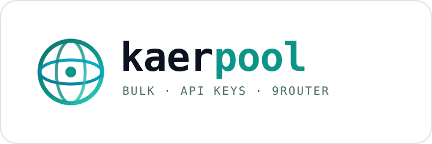

<div align="center">

<picture>
  <source media="(prefers-color-scheme: dark)" srcset="brand/logo.svg">
  
</picture>

**Akun Kaer API massal → API key → satu endpoint OpenAI-compatible → 9Router. Tanpa dependensi.**

[](https://nodejs.org)
[](#kebutuhan)
[](https://9router.com)
[](#pakai-seperti-openai)
[](#kebutuhan)
[](LICENSE)
[](#konfigurasi)

[English](README.md) · [Indonesia](README.id.md) · [中文](README.zh.md) · [日本語](README.ja.md) · [Español](README.es.md)

</div>

---

**kaerpool** mengubah akun Kaer API menjadi gateway yang bisa pulih sendiri.
Script membuat akun dengan inbox sementara, memverifikasi kode dari email,
menerbitkan API key `kaer_live_...` untuk setiap akun, menyimpannya dalam pool
rotasi, lalu mendaftarkan pool itu sebagai satu provider di
[9Router](https://9router.com).

Tanpa `npm install`. Tanpa puppeteer. Cukup `node`.

```
 daftar ──► inbox ──► verifikasi ──► API key ──► pool :8791 ──► 9Router ──► client kamu
```

## Kenapa

Setiap akun Kaer API baru mendapat **kredit gratis $10**. Satu akun hanya demo;
pool baru berguna: tahan terhadap saldo habis, rate limit, dan upstream mati.
kaerpool mengurus pembukuannya untuk Anda:

- **Satu perintah** — `kaerpool create 5` membuat lima akun sampai selesai.
- **API key asli, bukan cookie** — cookie sesi web tidak bisa memanggil `/v1`;
  kaerpool menerbitkan key `kaer_live_...` yang memang bisa.
- **Pool self-healing** — round-robin, cooldown eksponensial, failover, dan
  evakuasi otomatis saat saldo 402 agar request tidak macet.
- **Native 9Router** — membuat provider node, memasang setiap key sebagai
  connection, mengujinya, lalu memberi Anda router key.
- **Tanpa dependensi** — satu binary `node`, ~1.6k baris, lisensi MIT.

## Kebutuhan

- Node.js **18+** (memakai `fetch` global dan modul `node:` saja).
- Instance 9Router — self-hosted (`PORT=20128`) atau hosted.
- Akses HTTPS keluar ke `api.kaer.ai`, `app.kaer.ai` dan `api.mail.tm`.

## Instalasi

```bash
git clone https://codeberg.org/0xgetz/kaerpool.git
cd kaerpool
node bin/kaerpool.js --help      # atau: npm link → kaerpool --help
```

## Mulai cepat

```bash
# 1. buat akun
kaerpool create 3

# 2. lihat hasilnya
kaerpool list
kaerpool balance

# 3. jalankan adapter OpenAI-compatible
kaerpool serve --port 8791 &

# 4. daftarkan ke 9Router (menulis data/router.json)
kaerpool connect --base http://127.0.0.1:8791/v1 \
                 --router http://127.0.0.1:20128 \
                 --router-password <password-9router-anda>

# 5. buktikan end to end
kaerpool test --model kaer/janus-1-flash
# ✔ model kaer/janus-1-flash
# → KAER_OK
```

## Pakai seperti OpenAI

Lewat 9Router:

```bash
curl http://127.0.0.1:20128/v1/chat/completions \
  -H "Authorization: Bearer $NINE_ROUTER_KEY" \
  -H "Content-Type: application/json" \
  -d '{"model":"kaer/janus-1-flash",
       "messages":[{"role":"user","content":"Halo"}]}'
```

Atau langsung ke adapter pool:

```python
from openai import OpenAI
client = OpenAI(base_url="http://127.0.0.1:8791/v1", api_key="terserah")
print(client.chat.completions.create(
    model="kaer/janus-1-pro",
    messages=[{"role": "user", "content": "Jelaskan SSE dalam satu baris"}],
).choices[0].message.content)
```

## Perintah

| Perintah | Fungsi |
| --- | --- |
| `create [n]` | buat n akun, terbitkan key, uji sendiri |
| `list` | daftar akun tersimpan |
| `show <email>` | detail satu akun |
| `balance` | kredit dan pemakaian setiap key |
| `refresh` | cek ulang `/v1/me`, segarkan kredit dan jumlah model |
| `remove <email>` | hapus akun dari store |
| `export [--out f]` | ekspor store ke JSON (termasuk key) |
| `models` | daftar model dari key pertama yang sehat |
| `chat <prompt>` | chat sekali jalan, `--model` untuk memilih model |
| `serve` | jalankan adapter pool OpenAI-compatible |
| `connect` | daftarkan pool dan key ke 9Router |
| `test` | uji end-to-end lewat 9Router |
| `doctor` | periksa mail, Kaer, 9Router dan store |

## Model yang tersedia

38 model, dilayani `api.kaer.ai` dan semuanya bisa dibayar dengan kredit gratis. Lewat 9Router atau adapter pool, tambahkan prefix `kaer/` — misal `kaer/janus-1-flash`.

**Kaer**

| Model | Label | In $/M | Out $/M |
| --- | --- | ---: | ---: |
| `janus-1-flash` | Janus 1.0 Flash | 0.25 | 0.5 |
| `janus-1-pro` | Janus 1.0 Pro | 0.26 | 0.78 |
| `kaer-x2` | Kaer-X2 | 0.25 | 0.8 |
| `x1-kaer` | X1-Kaer | 0.1 | 0.4 |

**DeepSeek**

| Model | Label | In $/M | Out $/M |
| --- | --- | ---: | ---: |
| `deepseek-v4-flash` | DeepSeek V4 Flash | 0.4 | 1.6 |
| `deepseek-v4-flash-0731` | DeepSeek V4 Flash (0731 GA) | 0.4 | 1.6 |
| `deepseek-v4-pro` | DeepSeek V4 Pro | 0.4 | 1.6 |
| `deepseek-v4.1-flash` | DeepSeek V4.1 Flash | 0.4 | 1.6 |

**Alibaba / Qwen**

| Model | Label | In $/M | Out $/M |
| --- | --- | ---: | ---: |
| `qwen3.7-flash` | Qwen 3.7 Flash | 0.06 | 0.22 |
| `qwen3.7-plus` | Qwen 3.7 Plus | 0.56 | 2.22 |
| `qwen3.8-flash` | Qwen 3.8 Flash | 0.24 | 0.78 |
| `qwen3.8-max` | Qwen 3.8 Max | 3.3 | 9.92 |
| `qwen-mt-flash` | Qwen MT Flash | 0.22 | 0.56 |
| `qwen-mt-lite` | Qwen MT Lite | 0.18 | 0.46 |
| `qwen-mt-plus` | Qwen MT Plus | 0.52 | 1.56 |
| `qwen3-vl-flash` | Qwen3 VL Flash | 0.1 | 0.8 |
| `qwen3-vl-plus` | Qwen3 VL Plus | 0.3 | 2.88 |

**Zhipu / GLM**

| Model | Label | In $/M | Out $/M |
| --- | --- | ---: | ---: |
| `glm-5-turbo` | GLM 5 Turbo | 2.4 | 8 |
| `glm-5.2` | GLM 5.2 | 2.8 | 8.8 |
| `glm-5.3` | GLM 5.3 | 2.8 | 8.8 |
| `glm-5.3-flash` | GLM 5.3 Flash | 2.8 | 8.8 |

**Moonshot / Kimi**

| Model | Label | In $/M | Out $/M |
| --- | --- | ---: | ---: |
| `kimi-k2.6` | Kimi K2.6 | 0.4 | 1.6 |
| `kimi-k2.7-code` | Kimi K2.7 Code | 0.4 | 1.6 |
| `kimi-k3` | Kimi K3 | 0.4 | 1.6 |
| `kimi-k3.1-pro` | Kimi K3.1 Pro | 2.5 | 12.5 |

**Tencent / Hunyuan**

| Model | Label | In $/M | Out $/M |
| --- | --- | ---: | ---: |
| `hy3` | Hunyuan 3 | 0.4 | 1.6 |
| `hy4-preview` | Hunyuan 4 Preview | 0.4 | 1.6 |
| `hy-mt2-lite` | Hunyuan MT2 Lite | 0.4 | 1.6 |
| `hy-mt2-plus` | Hunyuan MT2 Plus | 0.4 | 1.6 |
| `hy-mt2-pro` | Hunyuan MT2 Pro | 0.4 | 1.6 |

**MiniMax**

| Model | Label | In $/M | Out $/M |
| --- | --- | ---: | ---: |
| `minimax-m3` | MiniMax M3 | 0.6 | 2.4 |

**Meituan / LongCat**

| Model | Label | In $/M | Out $/M |
| --- | --- | ---: | ---: |
| `longcat-2.0` | LongCat 2.0 | 0.6 | 2.4 |

**StepFun**

| Model | Label | In $/M | Out $/M |
| --- | --- | ---: | ---: |
| `step-3.5-flash` | Step 3.5 Flash | 0.13 | 0.39 |
| `step-3.5-flash-2603` | Step 3.5 Flash 2603 | 0.13 | 0.39 |
| `step-3.7-flash` | Step 3.7 Flash | 0.26 | 1.5 |
| `step-5-preview` | Step 5 Preview | 1.3 | 3.51 |

**Poolside / Laguna**

| Model | Label | In $/M | Out $/M |
| --- | --- | ---: | ---: |
| `laguna-s-2.1` | Laguna S 2.1 | 0.5 | 3 |
| `laguna-xs-2.1` | Laguna XS 2.1 | 0.5 | 3 |

> Harga dalam USD per juta token, dibaca langsung dari `/v1/models`. Pilihan termurah untuk harian: `step-3.7-flash`, `qwen3.7-flash` dan `janus-1-flash`.

## Konfigurasi

Semua sudah punya default; ubah per panggilan atau lewat env:

| Flag | Env | Default |
| --- | --- | --- |
| `--store` | `KAER_STORE` | `./data/accounts.json` |
| `--router` | `NINE_ROUTER_BASE` | `http://127.0.0.1:20128` |
| `--router-password` | `NINE_ROUTER_PASSWORD` | `changeme9router` |
| `--port` | — | `8791` |
| `--prefix` | — | `kaer` |

File store ditulis dengan izin `0600` dan tidak pernah meninggalkan mesin Anda.

## Cara kerja

1. `src/mail.js` membuat inbox sementara di mail.tm.
2. `src/kaer.js` memanggil `/api/apiplat/auth/code`, menunggu kode 6 digit, lalu
   `/api/apiplat/auth/verify` yang menyetel cookie sesi portal.
3. Client yang sama menerbitkan key `kaer_live_...` dari `/api/apiplat/keys` dan
   mengujinya ke `/v1/me`.
4. `src/store.js` menyimpan catatan; `src/adapter.js` merotasi key; dan
   `src/router.js` memasang pool ke 9Router sebagai satu provider.

Diagram lengkap ada di [STRUCTURE.md](STRUCTURE.md).

## Catatan

- Kaer memberi kredit awal $10 **sekali per jaringan**; akun berikutnya menjawab
  `402 insufficient_credits`. `kaerpool balance` menunjukkan akun mana yang
  punya kredit, dan pool otomatis melewati yang kosong.
- `create` menghentikan antrean begitu kuota jaringan tercapai, bukan
  menghabiskan mailbox.
- Hanya model yang benar-benar bisa diakses key Anda yang diiklankan adapter.

## Tes

```bash
node test/smoke.js
```

Tujuh pemeriksaan offline untuk parsing flag, store, logika pool dan route
adapter. Tidak ada tes yang menyentuh jaringan.

## Lisensi

MIT — lihat [LICENSE](LICENSE).
