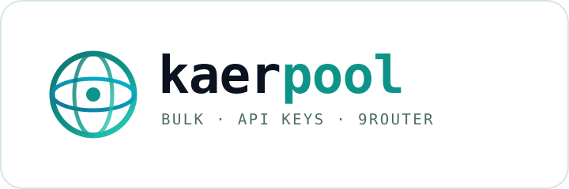

<div align="center">

<picture>
  <source media="(prefers-color-scheme: dark)" srcset="brand/logo.svg">
  
</picture>

**Kaer API アカウントを一括作成 → API キー → 1 つの OpenAI 互換エンドポイント → 9Router。依存ゼロ。**

[](https://nodejs.org)
[](#必要なもの)
[](https://9router.com)
[](#openai-として使う)
[](#必要なもの)
[](LICENSE)
[](#設定)

[English](README.md) · [Indonesia](README.id.md) · [中文](README.zh.md) · [日本語](README.ja.md) · [Español](README.es.md)

</div>

---

**kaerpool** は Kaer API アカウントを自己回復するゲートウェイに変えます。使い捨て
メールボックスでアカウントを作成し、届いた 6 桁コードで認証し、各アカウントの
`kaer_live_...` キーを発行してローテーションプールに保存し、そのプールを
[9Router](https://9router.com) の 1 つのプロバイダとして登録します。

`npm install` も puppeteer も不要。`node` だけで動きます。

```
 登録 ──► 受信箱 ──► 認証 ──► API キー ──► プール :8791 ──► 9Router ──► クライアント
```

## なぜ

新しい Kaer API アカウントには **$10 の無料クレジット**が付きます。1 アカウントは
デモですが、プールなら実用的なゲートウェイになります。残高切れ、レート制限、
上流障害があっても処理を止めません。

- **コマンド 1 つ** — `kaerpool create 5` で 5 アカウントを最後まで処理。
- **Cookie ではなく本物の API キー** — Web のセッション Cookie では `/v1` を
  呼べません。kaerpool は実際に使える `kaer_live_...` を発行します。
- **自己回復プール** — ラウンドロビン、指数バックオフ、フェイルオーバー、
  402 を検知したアカウントの自動除外。
- **9Router ネイティブ** — プロバイダノードを作成し、各キーを接続として登録・
  検証し、ルーターキーを返します。
- **依存ゼロ** — `node` 実行ファイル 1 つ、約 1.6k 行、MIT。

## 必要なもの

- Node.js **18+**（グローバル `fetch` と `node:` モジュールのみ使用）。
- 9Router インスタンス — セルフホスト（`PORT=20128`）または hosted。
- `api.kaer.ai`、`app.kaer.ai`、`api.mail.tm` への HTTPS 外向き通信。

## インストール

```bash
git clone https://codeberg.org/0xgetz/kaerpool.git
cd kaerpool
node bin/kaerpool.js --help      # または npm link → kaerpool --help
```

## クイックスタート

```bash
# 1. アカウント作成
kaerpool create 3

# 2. 結果を確認
kaerpool list
kaerpool balance

# 3. OpenAI 互換アダプタを起動
kaerpool serve --port 8791 &

# 4. 9Router に登録（data/router.json を書き出し）
kaerpool connect --base http://127.0.0.1:8791/v1 \
                 --router http://127.0.0.1:20128 \
                 --router-password <9Router のパスワード>

# 5. エンドツーエンド検証
kaerpool test --model kaer/janus-1-flash
# ✔ model kaer/janus-1-flash
# → KAER_OK
```

## OpenAI として使う

9Router 経由:

```bash
curl http://127.0.0.1:20128/v1/chat/completions \
  -H "Authorization: Bearer $NINE_ROUTER_KEY" \
  -H "Content-Type: application/json" \
  -d '{"model":"kaer/janus-1-flash",
       "messages":[{"role":"user","content":"こんにちは"}]}'
```

プールアダプタへ直接:

```python
from openai import OpenAI
client = OpenAI(base_url="http://127.0.0.1:8791/v1", api_key="任意")
print(client.chat.completions.create(
    model="kaer/janus-1-pro",
    messages=[{"role": "user", "content": "SSE を一行で説明して"}],
).choices[0].message.content)
```

## コマンド

| コマンド | 動作 |
| --- | --- |
| `create [n]` | n 個のアカウント作成・キー発行・自己テスト |
| `list` | 保存済みアカウント一覧 |
| `show <email>` | 1 アカウントの詳細 |
| `balance` | 各キーの残高と使用額 |
| `refresh` | `/v1/me` を再確認し残高・モデル数を更新 |
| `remove <email>` | ストアから削除 |
| `export [--out f]` | ストアを JSON に出力（キー含む） |
| `models` | 正常な最初のキーからモデル一覧 |
| `chat <prompt>` | 単発チャット、`--model` で指定 |
| `serve` | OpenAI 互換プールアダプタを起動 |
| `connect` | プールとキーを 9Router に登録 |
| `test` | 9Router 経由のエンドツーエンド検証 |
| `doctor` | メール・Kaer・9Router・ストアの診断 |

## 設定

すべて既定値で動作し、呼び出しごとか環境変数で上書きできます:

| フラグ | 環境変数 | 既定値 |
| --- | --- | --- |
| `--store` | `KAER_STORE` | `./data/accounts.json` |
| `--router` | `NINE_ROUTER_BASE` | `http://127.0.0.1:20128` |
| `--router-password` | `NINE_ROUTER_PASSWORD` | `changeme9router` |
| `--port` | — | `8791` |
| `--prefix` | — | `kaer` |

ストアは `0600` 権限で書き込まれ、あなたのマシンから出ることはありません。

## 仕組み

1. `src/mail.js` が mail.tm に使い捨て受信箱を作成。
2. `src/kaer.js` が `/api/apiplat/auth/code` を呼び、6 桁コードを待って
   `/api/apiplat/auth/verify` でポータルのセッション Cookie を取得。
3. 同じクライアントが `/api/apiplat/keys` で `kaer_live_...` を発行し、
   `/v1/me` で検証。
4. `src/store.js` が記録を保存し、`src/adapter.js` がキーをローテーションし、
   `src/router.js` がプールを 9Router に接続。

全体図は [STRUCTURE.md](STRUCTURE.md) を参照。

## 注意

- Kaer の $10 は **ネットワークごとに 1 回のみ**付与されます。それ以降の
  アカウントは `402 insufficient_credits` を返します。`kaerpool balance` で
  残高のあるアカウントを確認でき、プールは残りのアカウントを自動で除外します。
- ネットワーク上限に達すると `create` はキューを停止し、メールボックスを
  無駄に消費しません。
- アダプタは、あなたのキーで実際に到達できるモデルだけを公開します。

## テスト

```bash
node test/smoke.js
```

フラグ解析、ストア、プール計算、アダプタのルートを対象とした 7 つのオフライン
チェックです。ネットワークには一切アクセスしません。

## ライセンス

MIT — [LICENSE](LICENSE) を参照。
